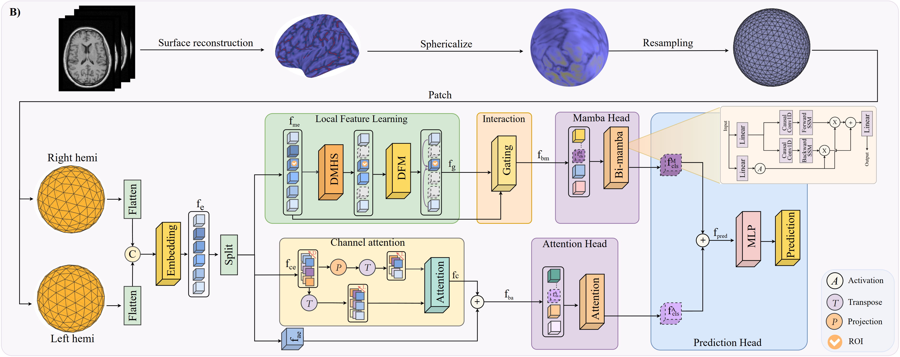

# ASAM: Adaptive Cortical Surface Representation via Dynamic Local Aggregation and Hybrid Attention–Mamba Global Modeling

Official PyTorch implementation of **ASAM** (**A**daptive **S**urface representation with **A**ttention and **M**amba), *Medical Image Analysis* (2026).

Sy Dat Tran, Hye Jin Yoon, Jin Kyu Gahm, for the Alzheimer's Disease Neuroimaging Initiative. Pusan National University.

ASAM is a hybrid network for cortical surface data. A Mamba branch and an Attention branch run in parallel over Ico-6 cortical patches of both hemispheres:

- **Dynamic Multi-Hop Selection (DMHS)** chooses a receptive field (1 to K_max hops) for every patch.
- **Dynamic Feature Merging (DFM)** builds a soft adjacency from geodesic distances and learned feature affinities.
- **Channel Attention (CA)** models dependencies between the morphometric feature channels.



## Main results

5-fold cross-validation, mean (SD) over folds, as reported in the paper.

**CN vs. MCI classification, ADNI-1 (N = 309)**

| Method | BACC | AUC | F1 | Precision | Recall |
|---|---|---|---|---|---|
| SiT | 65.92 (2.52) | 63.54 (2.65) | 72.13 (3.48) | 80.48 (3.29) | 65.35 (7.99) |
| SiM | 68.89 (2.15) | 69.11 (3.96) | 71.96 (3.30) | 83.02 (2.91) | 63.50 (7.32) |
| MS-SiT | 65.17 (5.20) | 64.44 (8.11) | 75.30 (7.39) | 78.88 (6.49) | 74.57 (16.57) |
| **ASAM** | **70.15 (1.46)** | **70.06 (4.18)** | **78.30 (4.20)** | 81.66 (2.01) | **75.92 (9.43)** |

**Brain age prediction, HBN (N = 886, 5–22 years)**

| Method | MAE (years) | Pearson R |
|---|---|---|
| SiT | 2.39 (0.17) | 0.50 (0.12) |
| SiM | 2.71 (0.18) | 0.26 (0.10) |
| MS-SiT | 2.19 (0.19) | **0.70 (0.11)** |
| **ASAM** | **2.14 (0.17)** | 0.67 (0.05) |

The paper also compares against graph and spherical CNNs (ChebNet, GAT, GConvNet, GIN, MoNet, Spherical UNet) and reports ablations, CN vs. AD, CN vs. MCI vs. AD, and cross-dataset results (HBN → ABIDE, IXI → DLBS).

## Installation

ASAM needs an NVIDIA GPU, because `mamba-ssm` runs only on CUDA. We tested it with Python 3.10, PyTorch 2.5.1, CUDA 12.1 and an H100.

**Option A, Docker (fastest).** The image used for the paper already contains every dependency:

```bash
git clone https://github.com/sydat2701/ASAM_surface.git && cd ASAM_surface
docker run --gpus all -it --rm -v $PWD:/workspace/ASAM -w /workspace/ASAM sydat2701/full_hymavi_nn:1.0 bash
```

**Option B, pip.**

```bash
git clone https://github.com/sydat2701/ASAM_surface.git && cd ASAM_surface
conda create -n asam python=3.10 -y && conda activate asam
pip install torch==2.5.1 --index-url https://download.pytorch.org/whl/cu121
pip install -r requirements.txt --no-build-isolation   # builds causal-conv1d / mamba-ssm against your torch
```

`environment.yml` describes the same environment for conda.

**Check the installation** without data, using one forward and backward pass on random input:

```bash
python scripts/smoke_test.py
# adni_cn_mci  output (2, 1)  parameters 12.18M  OK
# hbn_age      output (2, 1)  parameters 11.30M  OK
```

## Data preparation

ASAM takes FreeSurfer morphometry of both hemispheres, resampled to the Ico-6 sphere and cut into 320 triangular patches per hemisphere.

1. **Surface processing.** Use our preprocessing pipeline: **https://github.com/sydat2701/brain_surface_preprocessing**. It covers:
   - parallel FreeSurfer `recon-all`;
   - mapping of `curv`, `sulc` and `thickness` to `fsaverage`;
   - resampling to Ico-6 with Connectome Workbench. The template spheres are in `resources/ico6/`:

     ```bash
     wb_command -metric-resample lh.thickness.fsaverage.gii resources/ico6/lh.average.surf.gii \
         resources/ico6/ico-6.L.surf.gii BARYCENTRIC lh.thickness.fsaverage.shape.gii
     ```

   This gives one folder per subject:

   ```
   <surf_dir>/<subject_id>/{lh,rh}.{curv,sulc,thickness}.fsaverage.shape.gii   # 40,962 vertices each
   ```

2. **Patch arrays.** `scripts/make_patch_arrays.py` cuts every hemisphere into the patches of `resources/ico6/patches_ico6_320patches.csv` and stacks all subjects. `labels.csv` has the columns `subject_id,label`:
   - ADNI labels are `CN`, `sMCI`, `pMCI` or `Dementia`;
   - HBN labels are ages in years.

   ```bash
   # ADNI: features are z-scored per channel over all subjects (medial-wall zeros excluded), as in the paper
   python scripts/make_patch_arrays.py --surf_dir <adni_surf_dir> --labels_csv adni_labels.csv --out_dir data/adni --channel_znorm
   # HBN: raw features; train.py z-normalises every patch of every subject at load time
   python scripts/make_patch_arrays.py --surf_dir <hbn_surf_dir> --labels_csv hbn_labels.csv --out_dir data/hbn
   ```

The expected folder structure and file formats are:

```
data/
├── adni/
│   ├── data_ico6.npy   # float, (N, 3, 640, 153)
│   ├── labels.npy      # int, (N,)  0 = CN, 1 = sMCI, 2 = pMCI, 3 = AD
│   └── subs.npy        # str, (N,)  ADNI subject ids, e.g. 007_S_0698
└── hbn/
    ├── data_ico6.npy   # float, (N, 3, 640, 153)
    ├── labels.npy      # float, (N,)  age in years
    └── subs.npy        # str, (N,)  e.g. sub-NDARYM832PX3
```

In `data_ico6.npy`, the axes are as follows:
- **channels:** curvature, sulcal depth, cortical thickness;
- **patches:** 0–319 are the left hemisphere and 320–639 the right hemisphere;
- **vertices:** 153 per patch.

For CN vs. MCI, sMCI and pMCI are merged into one MCI class and AD subjects are not used.

**Cohorts.**
- ADNI-1: the CN vs. MCI task uses 309 subjects (101 CN, 208 MCI).
- HBN: 886 typically developing participants from three sites, aged 5–22 years.

The imaging data must be obtained from [ADNI](https://adni.loni.usc.edu) and the [Healthy Brain Network](https://fcon_1000.projects.nitrc.org/indi/cmi_healthy_brain_network/) under their data use agreements. We do not redistribute them.

**Cross-validation folds.** `splits/adni_cn_mci_5fold.csv` and `splits/hbn_age_5fold.csv` give the fold of every subject used in the paper. `train.py` and `evaluate.py` use these files by default and match subjects through `subs.npy`, so the folds are identical to the paper whatever the order of your arrays. With `--split_file none`, the folds are generated again instead:
- ADNI uses `StratifiedKFold(5, shuffle=True, random_state=2022)`;
- HBN uses `KFold(5, shuffle=True, random_state=42)`.

## Pretrained weights

The five fold models of each task are available on [Google Drive](https://drive.google.com/drive/folders/1jZgArjCP7TYGdujF8CIg54QQdxF2XOip?usp=sharing). Each `fold{k}.pth` is evaluated on the held-out subjects of fold k.

| File | Content | SHA-256 |
|---|---|---|
| `asam_adni_cn_mci.zip` | ADNI CN vs. MCI, 5 fold models (retrained with this repository) | `c725f7acbdbd7c99ef8c3150ff06b4bdfc4af6de05b62c5781380785a8100383` |
| `asam_hbn_age.zip` | HBN brain age, 5 fold models (paper checkpoints) | `cbf081050f9783dd6707857cc0bdbf72e12ceb35f63502c07e047fea125ee4ce` |
| `asam_adni_cn_mci_original.zip` | ADNI CN vs. MCI, original paper checkpoints (see the note under Evaluation) | `8b1389d4ec199339fb9087a88db245eab6724cde696f741bc099580b2e3d5383` |

Download the zips into `weights/` (in the browser, or with `pip install gdown && gdown --folder <link above> -O weights`), then:

```bash
cd weights && unzip asam_adni_cn_mci.zip && unzip asam_hbn_age.zip && cd ..
```

## Evaluation

```bash
python evaluate.py --task hbn_age     --data_dir data/hbn  --weights_dir weights/hbn_age
python evaluate.py --task adni_cn_mci --data_dir data/adni --weights_dir weights/adni_cn_mci
```

With the released HBN weights, the expected output is:

```
fold 0: mae=1.9509, r=0.7220
fold 1: mae=1.9679, r=0.7228
fold 2: mae=2.3752, r=0.6046
fold 3: mae=2.2781, r=0.6348
fold 4: mae=2.1149, r=0.6829
mean (SD) over folds:  mae 2.14 (0.17)   r 0.67 (0.05)
```

Retraining with `train.py` from this repository gives MAE 2.26 (0.14), R 0.62 (0.05).

With the released ADNI weights (retrained with `train.py` from this repository), the expected output is:

```
fold 0: bacc=0.6595, auc=0.6226, f1=0.7027, pre=0.8125, sen=0.6190
fold 1: bacc=0.6774, auc=0.6440, f1=0.5667, pre=0.9444, sen=0.4048
fold 2: bacc=0.7095, auc=0.6405, f1=0.7222, pre=0.8667, sen=0.6190
fold 3: bacc=0.6754, auc=0.6051, f1=0.7595, pre=0.7895, sen=0.7317
fold 4: bacc=0.7049, auc=0.7171, f1=0.7143, pre=0.8621, sen=0.6098
mean (SD) over folds [%]:  bacc 68.53 (1.90)   auc 64.59 (3.82)
```

Note: in the original experiments, the ADNI checkpoints were selected and scored while the training-time input noise (std 1) was still active during validation, so the ADNI values in the paper are noisy-evaluation scores. `evaluate.py` and the validation in `train.py` are deterministic (no noise). Evaluated this way, the original paper checkpoints give BACC 63.05 (2.09), AUC 66.38 (1.96); the released retrained checkpoints give the numbers above.

Use `--save_predictions preds.csv` to write the per-subject outputs.

## Training

5-fold cross-validation with the configuration of the paper. Checkpoints `fold{k}.pth` and per-epoch logs are written to `--out_dir`.

```bash
# CN vs. MCI classification (ADNI)
python train.py --task adni_cn_mci --data_dir data/adni --out_dir runs/adni_cn_mci
python evaluate.py --task adni_cn_mci --data_dir data/adni --weights_dir runs/adni_cn_mci

# Brain age prediction (HBN)
python train.py --task hbn_age --data_dir data/hbn --out_dir runs/hbn_age
python evaluate.py --task hbn_age --data_dir data/hbn --weights_dir runs/hbn_age
```

Use `--folds 0` to train a single fold. The main hyperparameters can be overridden from the command line (`--epochs`, `--lr`, `--k_max`, `--kappa`, `--epsilon`, `--alpha`, …). On one H100, a fold takes about 1–1.5 h for ADNI (120 epochs) and up to about 5 h for HBN (at most 250 epochs, usually stopped early).

## Configuration

All defaults are in [`asam/config.py`](asam/config.py).

| | Symbol in paper | Value |
|---|---|---|
| Embedding dimension | D | 384 |
| Mamba state size | N | 16 |
| Attention heads | | 8 |
| Minimum / maximum hop | K_min / K_max | 1 / 5 |
| Survival threshold (DMHS) | κ | 0.6 |
| Affinity cut-off (DFM) | ε | 0.8 |
| Geodesic vs. dynamic affinity weight | α | 0.5 |
| Mamba / Attention / CA blocks | | 1 / 6 / 6 (ADNI), 1 / 5 / 6 (HBN) |
| Optimiser | | AdamW, lr 1e-4, weight decay 1e-4 |
| Learning-rate schedule | γ, λ | λ·lr₀·(1 − t/T)^γ, γ = 0.9, λ = 0.8 |
| Input noise during training | | Gaussian, σ = 1 |

The two tasks differ in their training protocol:

| | ADNI CN vs. MCI | HBN brain age |
|---|---|---|
| Loss | BCE | L1 (MAE), targets = age / 100 |
| Epochs | 120 | 250, early stopping with patience 60 |
| Batch size | 8, class-balanced over-sampling | 24 |
| Input normalisation | per channel over subjects (preprocessing) | per subject and patch (at load time) |
| Checkpoint selection | best BACC on the held-out fold | best MAE on the held-out fold |
| Seed | 55 | 55 |

## Repository structure

```
asam/
  config.py      # hyperparameters and task presets
  model.py       # ASAM: DMHS, DFM, gated update, Mamba / Attention branches, CA
  layers.py      # building blocks
  data.py        # data loading, normalisation, folds
  engine.py      # training / evaluation loops and metrics
train.py, evaluate.py
scripts/         # make_patch_arrays.py (data preparation), smoke_test.py
resources/ico6/  # Ico-6 template spheres, 320-patch definition, hop neighbourhoods, geodesic distances
splits/          # 5-fold assignment of the paper's subjects
```

## Citation

If you use this code, please cite our paper. The entry is provisional; the DOI will be added when the article is online.

```bibtex
@article{tran2026asam,
  title   = {{ASAM}: Adaptive Cortical Surface Representation via Dynamic Local Aggregation and Hybrid Attention--Mamba Global Modeling},
  author  = {Tran, Sy Dat and Yoon, Hye Jin and Gahm, Jin Kyu and {Alzheimer's Disease Neuroimaging Initiative}},
  journal = {Medical Image Analysis},
  year    = {2026},
  note    = {In press}
}
```

## License

MIT, see [LICENSE](LICENSE).

## Acknowledgements

Data used in this work were obtained from the Alzheimer's Disease Neuroimaging Initiative (ADNI) database (adni.loni.usc.edu) and the Child Mind Institute Healthy Brain Network. The ADNI investigators contributed to the design and implementation of ADNI and/or provided data but did not participate in the analysis or writing of this work.
